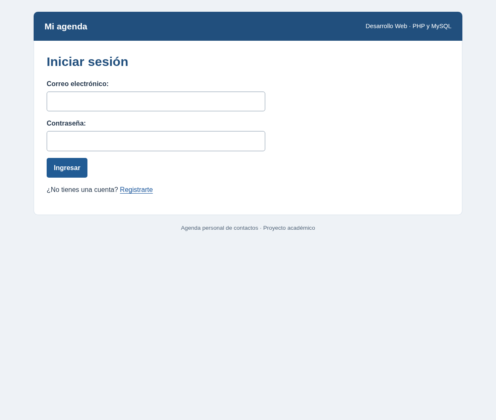
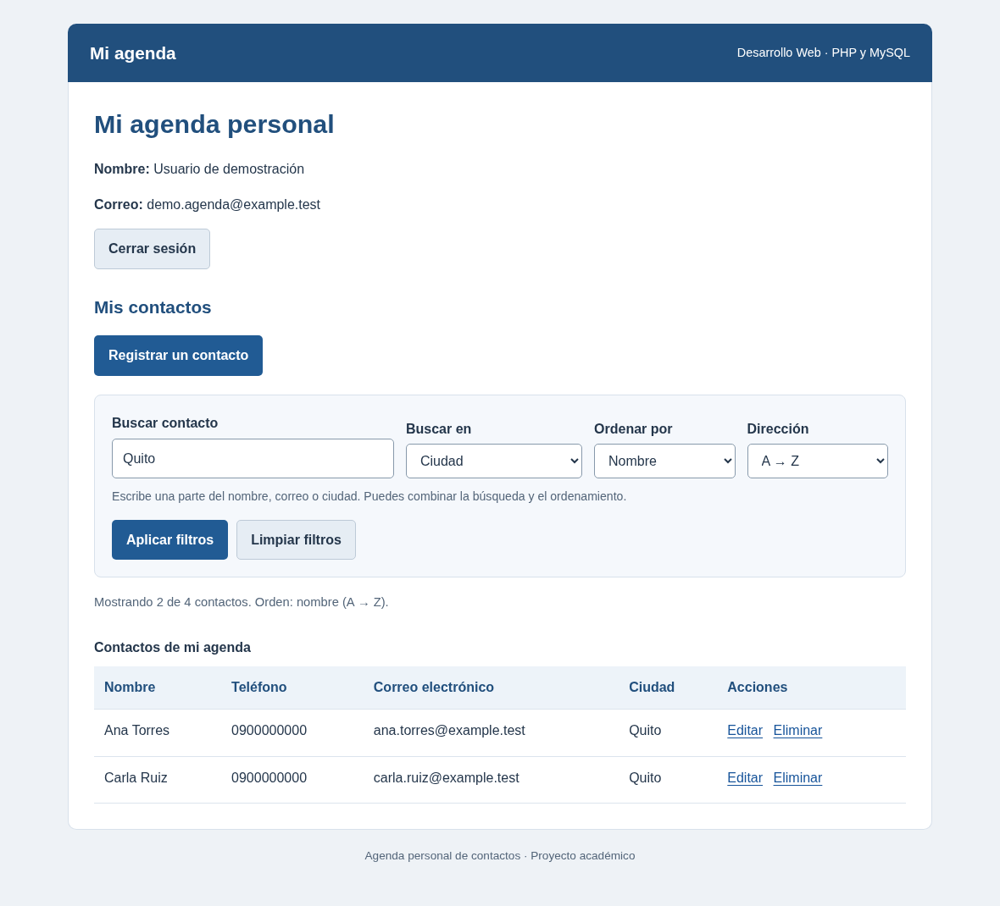
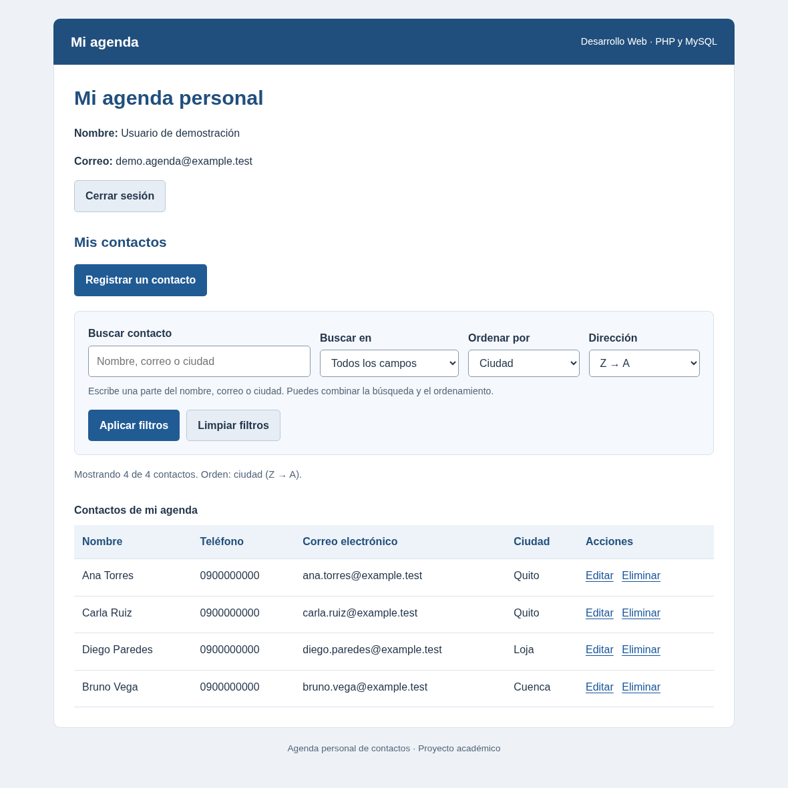

# Agenda personal de contactos · Versión 2

Aplicación académica en PHP y MySQL para registrar usuarios y administrar una agenda privada. Esta versión incorpora **A: búsqueda** y **B: ordenamiento**, y prepara el sistema para un hosting con PHP y MySQL.

## Enlaces y estado de publicación

- **URL pública del sistema:** pendiente de publicación. Sustituir esta línea por la URL HTTPS real después de desplegar y comprobar la aplicación.
- **Repositorio:** https://github.com/ATIK-99/agenda-contactos/tree/master
- **Script SQL:** [sql/agenda.sql](sql/agenda.sql).
- **Hosting previsto:** InfinityFree. El enlace del repositorio permite consultar el código, pero no ejecuta PHP ni MySQL.

## Mejoras respecto a la versión anterior

| Mejora | Versión anterior | Versión 2 |
| --- | --- | --- |
| A. Búsqueda | Listado completo, sin buscador | Búsqueda parcial por nombre, correo o ciudad; permite elegir un campo o los tres |
| B. Ordenamiento | Orden fijo por nombre | Selección de nombre o ciudad, en dirección A → Z o Z → A |
| Uso combinado | Sin controles de filtrado | Búsqueda y ordenamiento simultáneos, valores conservados en la URL y botón para limpiar |
| Mensajes | Aviso de agenda vacía | Distingue agenda vacía de búsqueda sin coincidencias y muestra cantidad de resultados |
| Instalación | SQL vinculado al nombre local de la base | SQL importable en la base seleccionada, incluso si el hosting asigna un prefijo |
| Configuración | Plantilla local | Plantillas para XAMPP y hosting; credenciales privadas fuera de Git |

El ordenamiento por ciudad usa nombre e identificador como desempate. No se añadió fecha de creación a contactos, pues la consigna la considera opcional. No se implementaron categorías ni favoritos: se cumplen las dos mejoras mínimas mediante A y B.

## Funcionalidades conservadas

- Registro con correo único y contraseña protegida con password_hash().
- Acceso con password_verify() y renovación del identificador de sesión.
- Panel privado y creación, edición y eliminación de contactos con confirmación.
- Validación en servidor, consultas preparadas PDO, escape HTML y tokens CSRF.
- Aislamiento por id_usuario en lectura, búsqueda, edición y eliminación.
- Cierre de sesión mediante POST y eliminación de la cookie.
- Diseño adaptable, sin JavaScript ni frameworks.

La búsqueda utiliza consultas preparadas. El campo y la dirección del ordenamiento se validan mediante listas permitidas. Los caracteres % y _ se buscan literalmente.

## Capturas de pantalla

Capturas de la versión 2 ejecutada **en un entorno local de prueba**, con datos ficticios. No constituyen evidencia de publicación en Internet. Después del despliegue se debe comprobar la misma aplicación desde su URL pública.

### Inicio de sesión

### Panel y controles nuevos

### Búsqueda por ciudad

### Ordenamiento por ciudad

## Tecnologías y requisitos

PHP 8.0 o superior con extensiones pdo_mysql y mbstring; MySQL o MariaDB con InnoDB y utf8mb4; HTML5 y CSS3. En local se utiliza Apache y phpMyAdmin mediante XAMPP. No requiere Composer, Node.js ni servicios externos de interfaz.

## Instalación local desde cero

1. Copiar la carpeta agenda-contactos en C:\xampp\htdocs.
2. Iniciar Apache y MySQL desde XAMPP.
3. Abrir http://localhost/phpmyadmin/ y crear una base llamada **agenda_personal**, con cotejamiento utf8mb4_unicode_ci.
4. Seleccionar esa base y, en **Importar**, ejecutar **sql/agenda.sql**. Crea las tablas usuarios y contactos; no crea la base ni inserta cuentas.
5. Copiar config/local.ejemplo.php como **config/local.php**. Revisar servidor, puerto, base, usuario y contraseña.
6. La configuración local utiliza 127.0.0.1 y puerto MySQL **3307**. Si tu instalación utiliza 3306, cambiar ese valor en config/local.php. El puerto MySQL no se escribe en la URL del navegador.
7. Abrir http://localhost/agenda-contactos/, registrarse e iniciar sesión. No hay cuentas ni contraseñas predeterminadas.
8. Registrar contactos y probar los filtros. Consultar [docs/PRUEBAS.md](docs/PRUEBAS.md).

Si Apache utiliza otro puerto, incorporarlo a la dirección del navegador.

## Actualizar una instalación existente

1. Conservar una copia de la carpeta actual y una exportación de la base antes de reemplazar archivos.
2. Copiar la versión 2 sobre la carpeta existente, **conservando .git y config/local.php**.
3. **No es necesario volver a importar el SQL ni modificar las tablas originales.** Las mejoras usan los campos existentes y los contactos se mantienen.
4. Abrir la aplicación y recargar con Ctrl + F5.

El SQL usa CREATE TABLE IF NOT EXISTS: conserva las tablas existentes, pero no corrige una estructura diferente de la original. El script distribuido contiene solo estructura. Para trasladar también registros locales al hosting, se necesita una exportación privada independiente.

## Publicación en InfinityFree

Guía completa: [docs/DESPLIEGUE.md](docs/DESPLIEGUE.md).

1. Crear la cuenta gratuita y un sitio con subdominio.
2. Crear una base desde **MySQL Databases**, abrir phpMyAdmin, seleccionar esa base e importar sql/agenda.sql.
3. Copiar config/hosting.ejemplo.php como config/local.php **en el hosting** y completar hostname MySQL, nombre completo de base, usuario y contraseña.
4. Subir los archivos de ejecución a **htdocs**, conservando assets, config e includes. index.php debe quedar directamente dentro de htdocs.
5. Configurar HTTPS y probar registro, acceso, CRUD, búsqueda y ordenamiento desde Internet.
6. Reemplazar el estado pendiente al inicio del README por la URL HTTPS comprobada y actualizar el repositorio.

config/local.php está excluido por .gitignore. Su contenido cambia entre XAMPP y hosting. El hostname MySQL de InfinityFree se obtiene del panel; no se usa el 127.0.0.1 de XAMPP.

## Archivos principales

| Ruta | Función |
| --- | --- |
| index.php | Redirección según sesión |
| registro.php, login.php, logout.php | Autenticación |
| panel.php | Listado, búsqueda y ordenamiento |
| crear_contacto.php, editar_contacto.php, eliminar_contacto.php | Gestión de contactos |
| includes/ | Sesiones, autenticación y validaciones |
| config/conexion.php | Conexión PDO |
| config/local.ejemplo.php | Plantilla para XAMPP |
| config/hosting.ejemplo.php | Plantilla para hosting |
| assets/css/estilos.css | Estilos y controles adaptables |
| sql/agenda.sql | Estructura de base de datos |
| docs/capturas/ | Capturas incluidas en el README |
| docs/DESPLIEGUE.md | Publicación y configuración |
| docs/ENTREGA.md | Actualización de GitHub y entrega |
| docs/PRUEBAS.md, docs/REVISION.md | Casos y resultados de verificación |

## Modelo de datos

usuarios: id, nombre, correo, password y fecha_registro.

contactos: id, id_usuario, nombre, telefono, correo y ciudad.

La clave foránea contactos.id_usuario vincula cada contacto con su propietario. El correo de usuario es único. La contraseña se almacena como hash y el teléfono como texto para conservar prefijos y ceros iniciales.

## Entregables

- URL pública del sistema funcionando, pendiente hasta completar el despliegue.
- Repositorio GitHub actualizado en master, incluyendo README y capturas.
- Script sql/agenda.sql.

La validación en Internet y la actualización del repositorio se comprueban por separado de las pruebas locales. Véase [docs/REVISION.md](docs/REVISION.md).
